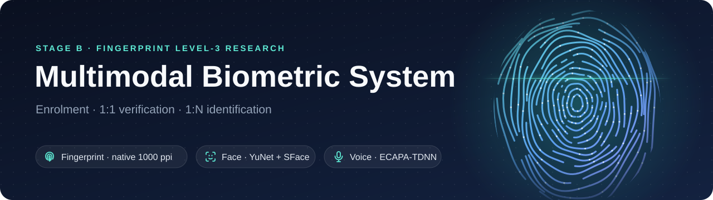
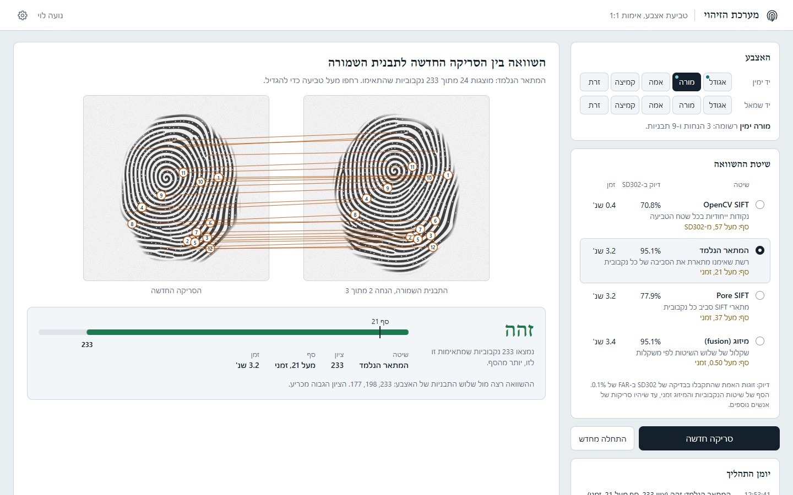
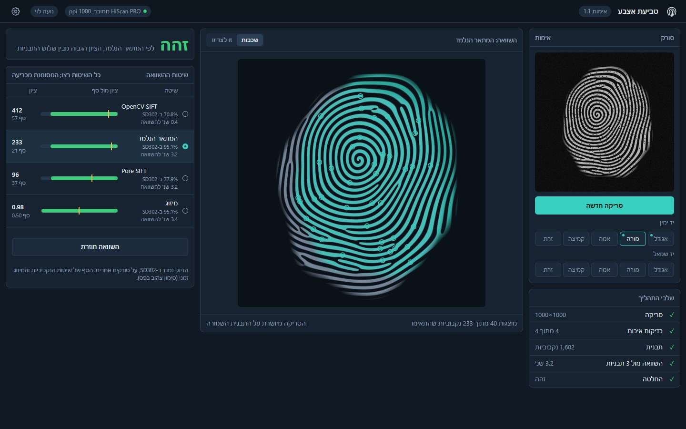
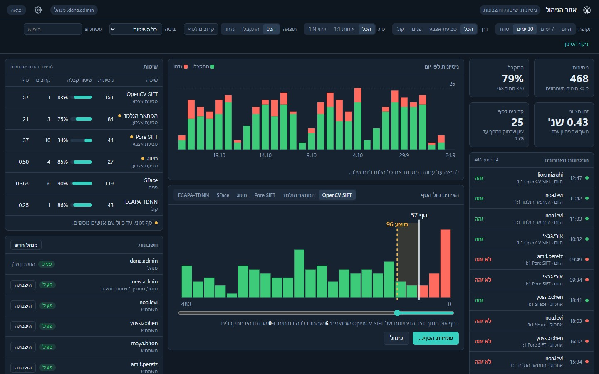
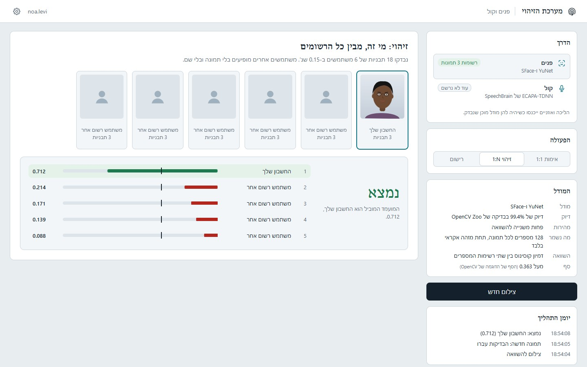
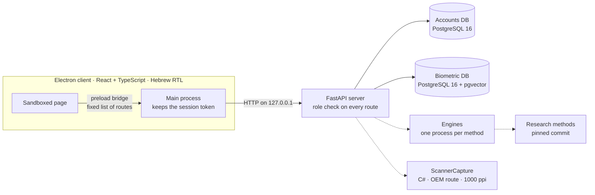

<p align="center">
  
</p>

<p align="center">
  
  
  
  
  
  
  
</p>
<p align="center">
  
  
  
</p>

A desktop system that recognises a person by **fingerprint, face and voice**: enrolment once, then
**1:1 verification** or **1:N identification**, in a Hebrew, right-to-left client. It is Stage B of
[fingerprint-level3-recognition-research](https://github.com/Mish2000/fingerprint-level3-recognition-research),
an academic research project on level-3 fingerprint features such as sweat pores: the research's own
matching methods run inside the system, on native 1000 ppi captures.

> [!NOTE]
> Built in six approved increments. The first, accounts, roles and the client's skeleton, is being
> completed while the client's visual direction is chosen with the academic supervisor.

## Screenshots

Interactive design prototypes of the client, from the directions under review with the supervisor.
Every print, face, account and score in them is synthetic.

<table>
<tr>
<td width="50%" valign="top">

<p><b>Fingerprint · 1:1 verification</b><br>
<sub>Matched sweat pores, numbered, between the stored template and the new capture, beside each method's accuracy on SD302 and its time.</sub></p>
</td>
<td width="50%" valign="top">

<p><b>Fingerprint · control room</b><br>
<sub>The new capture aligned on the template with its matched pores, and every method's score against its threshold.</sub></p>
</td>
</tr>
<tr>
<td valign="top">

<p><b>Administration</b><br>
<sub>Attempts per day and a method's score distribution; dragging a threshold shows which recent decisions it would change, before it is saved.</sub></p>
</td>
<td valign="top">

<p><b>Face · 1:N identification</b><br>
<sub>A search across everyone enrolled, ranked by similarity against the threshold; other users appear without a name or a picture.</sub></p>
</td>
</tr>
</table>

## Highlights

<table>
<tr>
<td width="33%" valign="top">

**🔬 Fingerprint methods from the research**<br>
Keypoints and sweat pores at a native 1000 ppi, matched by three methods from the research and
their fusion.

</td>
<td width="33%" valign="top">

**🛡️ Privacy by design**<br>
The national ID is never stored. Every sample and template is sealed with its own key, and the
two databases share no identifier.

</td>
<td width="33%" valign="top">

**🧩 One flow, three modalities**<br>
Fingerprint, face and voice share one experience: enrol once, then verify or identify, with a
visual result.

</td>
</tr>
<tr>
<td valign="top">

**🔌 Native capture, recovered**<br>
The scanner's driver offers only 500 ppi, so the capture tool reaches its OEM library directly for
checked 1000 ppi images.

</td>
<td valign="top">

**📜 Every decision on record**<br>
Each design choice is numbered (H1 to H28), dated, and cited in the code and the commits.

</td>
<td valign="top">

**✅ Tested end to end**<br>
Server tests run against a throwaway PostgreSQL cluster; the client's main process and its screens
have tests of their own.

</td>
</tr>
</table>

## Modalities

| | Capture | Method | Template | Decision |
| --- | --- | --- | --- | --- |
| 👆 **Fingerprint** | Biometrika HiScan PRO, native 1000 ppi | OpenCV SIFT · Pore SIFT · learned pore descriptor · fusion | local descriptors, sealed | score above the method's threshold |
| 🙂 **Face** | the PC's camera | YuNet detection + SFace | embedding in pgvector | cosine similarity above 0.363 |
| 🎙️ **Voice** | the PC's microphone, 16 kHz mono | SpeechBrain ECAPA-TDNN | 192-value embedding in pgvector | cosine similarity above 0.25 |

Run unchanged on the scanner's own captures, OpenCV SIFT accepted 28 of 30 same-finger pairs and
none of 405 different-finger pairs within one session; across two sessions, results fell sharply
([evaluation](docs/hiscan-methods.md)).

## Architecture



<sub>Dashed links arrive with the next increments. Everything runs on one PC; nothing listens beyond localhost.</sub>

## Security

- 🪪 **National ID**: checked by its check digit, kept only as an HMAC-SHA256 for duplicate checks.
- 🔐 **Sealed data**: raw samples, the captures of attempts and fingerprint templates use AES-256-GCM under a per-record
  HKDF-SHA256 key, bound to their row and to their person.
- 🧱 **Two databases**: accounts hold only an encrypted link to a random subject identifier; biometric rows
  name people by that identifier alone.
- 🔑 **Accounts**: Argon2id passwords, throttled sign-ins, session tokens stored only as hashes, and an
  insert-only audit log of every administrative action.
- 🚪 **Deny by default**: each API route declares its roles and is checked on every request; the client's
  page has no Node.js and never sees the session token.

## Roadmap

| | Increment | |
| --- | --- | --- |
| 🟡 | **1 · Foundation** | environments, local PostgreSQL + pgvector, accounts, roles, administration, the client's skeleton |
| ⚪ | **2 · Fingerprint, 1:1** | enrolment and verification with OpenCV SIFT, encrypted storage, attempt history |
| ⚪ | **3 · Fingerprint, complete** | all methods, the method choice, 1:N and the match drawings |
| ⚪ | **4 · Face** | enrolment, 1:1 and 1:N |
| ⚪ | **5 · Voice** | enrolment, 1:1 and 1:N |
| ⚪ | **6 · Finish** | thresholds and history in the administration, fusion, the finished experience |

## Repository

```text
client/        Electron + React + TypeScript client
server/        FastAPI server, accounts, keys and the local PostgreSQL cluster
scanner/       ScannerCapture: native 1000 ppi capture (C#, .NET Framework 4.8, x86)
methods/       pinned link to the research methods and their evaluation on the scanner
docs/          specification, data model, decision record and validations
environments/  locked conda environments of the server and the database
```

<details>
<summary><b>Getting started</b> (Windows)</summary>

```bash
# The server and its database, from their locked conda environments
conda create -n multimodal-server --file environments/server-win-64.lock
conda create -n multimodal-postgres --file environments/postgres-win-64.lock
conda activate multimodal-server
cd server
python -m mbs setup        # key file, local settings, cluster and databases
python -m mbs serve        # the API on 127.0.0.1:55433
python -m pytest           # 43 tests against a throwaway cluster

# The client, from its lock file
cd ../client
npm ci
npm run dev                # the app, with the server running
npm test                   # 18 tests
```

Details: [server](server/README.md) · [scanner](scanner/README.md) · [research methods](methods/README.md)
</details>

## Documentation

[Specification](docs/specification.md) · [Data model](docs/data-model.md) · [Decision record](docs/decisions.md) ·
[Native scanner capture](docs/scanner-native-capture.md) · [Methods on the scanner](docs/hiscan-methods.md)

---

<p align="center"><sub>By <b>Michael Sirkovich</b>, Stage B of
<a href="https://github.com/Mish2000/fingerprint-level3-recognition-research">fingerprint-level3-recognition-research</a>,
under academic supervision.</sub></p>
