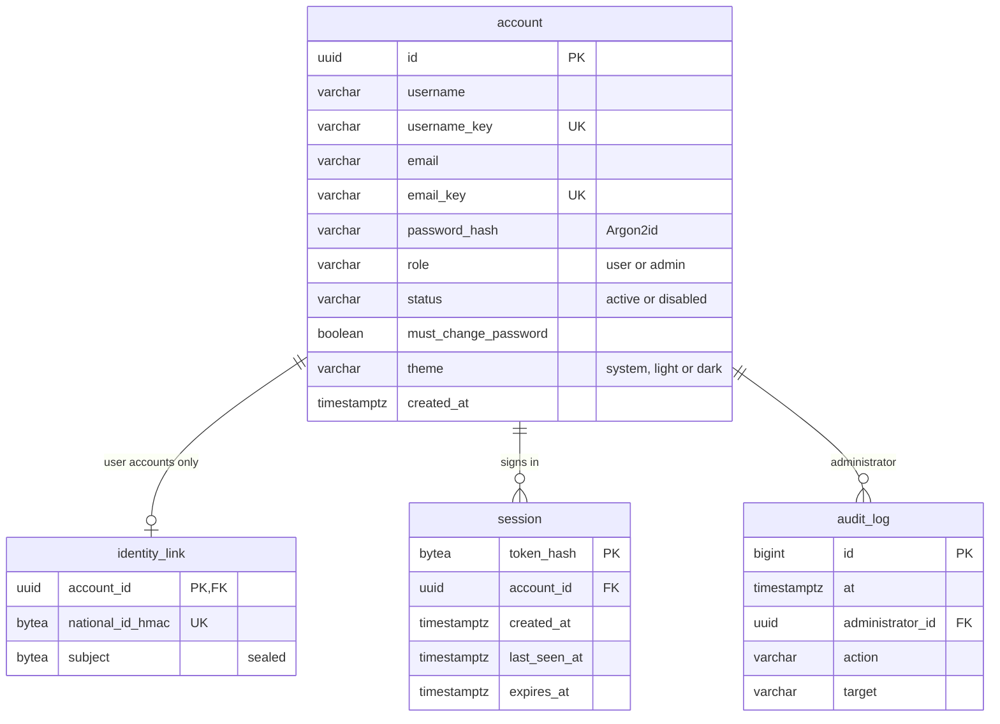
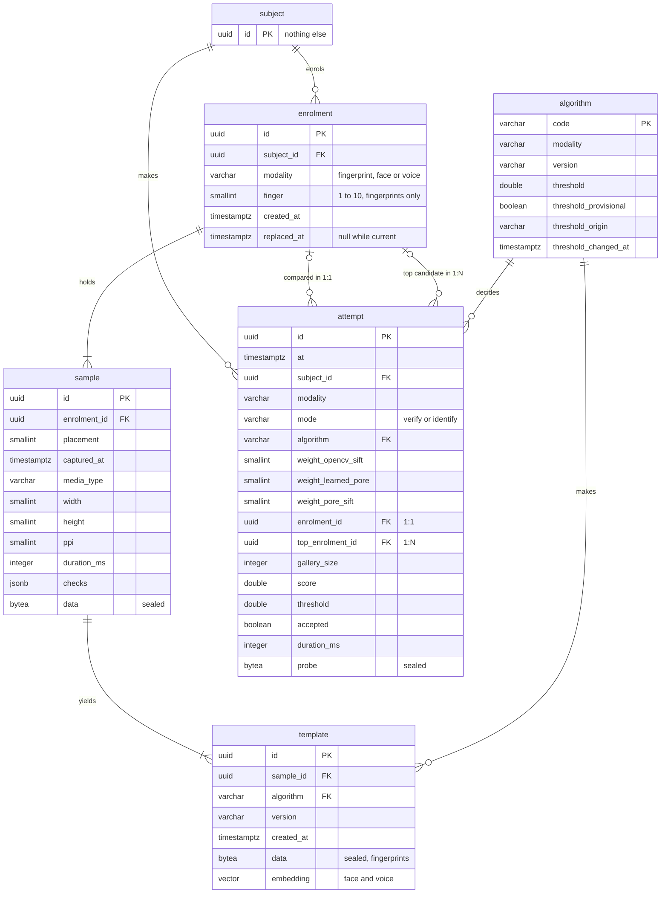

# Data model

Approved by the researcher on 2026-10-21 (H25 in `docs/decisions.md`): the
exact tables of the two databases of `docs/specification.md` (section 4),
with every column, type, key and sealed value, and how one person holds many
findings. Types are PostgreSQL 16's; every `uuid` is random (version 4). The
accounts database, with the account's `theme` column (H24, H26), and the
biometric `subject` table exist (H23); the other biometric tables are built
in increments 2 to 6 (H20).

## Principles

- Two databases, each with its own login role (H23). `mbs_accounts` holds
  the accounts; `mbs_biometric` holds the findings and names people only by
  random subject identifiers. They share no key: only the sealed identity
  link leads from an account to its subject (H3, H14).
- A finding is one raw capture: a fingerprint image, a face image or a voice
  recording. It is stored sealed, and every method makes its own template
  from it, so a change of method needs no new capture (H6).
- A sealed value is AES-256-GCM under a key derived for that value alone
  (HKDF-SHA256 with a random 32-byte salt and a label per use), stored as one
  `bytea`: `MBS1`, the key version (2 bytes), the salt (32), the nonce (12),
  then the ciphertext and its 16-byte tag, 66 bytes more than the plaintext.
  The header, the label and the row's identity are associated data, so a
  sealed value opens only in its own row (H14):

  | Sealed column | Label | Row identity |
  | --- | --- | --- |
  | `identity_link.subject` | `mbs/identity-link/v1` | `account_id` |
  | `sample.data` | `mbs/sample/v1` | `sample.id`, then the enrolment's `subject_id` |
  | `template.data` | `mbs/template/v1` | `template.id`, the subject's id, then the `algorithm` code |
  | `attempt.probe` | `mbs/probe/v1` | `attempt.id`, then `subject_id` |

  Because the subject is part of the row identity, a finding or template
  moved to another person no longer opens.

## Accounts database (`mbs_accounts`)

### `account`: a user or an administrator (H12)

| Column | Type | Rules |
| --- | --- | --- |
| `id` | `uuid` | primary key |
| `username` | `varchar(32)` | as typed: 3 to 32 letters or digits of any script, with `.`, `_` and `-` inside (H23) |
| `username_key` | `varchar(32)` | unique: the case-folded username, used to sign in |
| `email` | `varchar(254)` | as typed |
| `email_key` | `varchar(254)` | unique: the case-folded email |
| `password_hash` | `varchar(200)` | Argon2id as a PHC string (H14) |
| `role` | `varchar(8)` | `user` or `admin` |
| `status` | `varchar(8)` | `active` or `disabled`; a disabled account cannot sign in and leaves the 1:N gallery |
| `must_change_password` | `boolean` | true while an administrator's one-time password is unchanged |
| `theme` | `varchar(8)` | `system` (the default, Windows' setting), `light` or `dark` (H24) |
| `created_at` | `timestamptz` | |

### `identity_link`: user accounts only (H3)

| Column | Type | Rules |
| --- | --- | --- |
| `account_id` | `uuid` | primary key; references `account.id`, deleted with it |
| `national_id_hmac` | `bytea` (32) | unique: HMAC-SHA256 of the national ID under its own key, so a second account with the same ID is refused; the number itself is never stored |
| `subject` | `bytea` | the sealed subject identifier (82 bytes) |

### `session`: a sign-in (H14)

| Column | Type | Rules |
| --- | --- | --- |
| `token_hash` | `bytea` (32) | primary key: SHA-256 of the session token, which is never stored |
| `account_id` | `uuid` | references `account.id`, deleted with it; indexed |
| `created_at` | `timestamptz` | |
| `last_seen_at` | `timestamptz` | the session ends 30 minutes after it (H23) |
| `expires_at` | `timestamptz` | 12 hours after `created_at`; the session ends then at the latest |

### `audit_log`: administrative changes (H12)

Insert-only: a trigger refuses updates, deletes and truncation.

| Column | Type | Rules |
| --- | --- | --- |
| `id` | `bigint` | primary key, generated |
| `at` | `timestamptz` | |
| `administrator_id` | `uuid` | references `account.id` |
| `action` | `varchar(40)` | `first_administrator`, `create_administrator`, `disable_account`, `enable_account`; `change_threshold` from increment 6 |
| `target` | `varchar(200)` | the account's username, or the algorithm's code |

## Biometric database (`mbs_biometric`)

### `subject`: a person (H3)

| Column | Type | Rules |
| --- | --- | --- |
| `id` | `uuid` | primary key; nothing else is kept, not even a creation time (H23) |

### `algorithm`: the methods and their thresholds (H16)

| Column | Type | Rules |
| --- | --- | --- |
| `code` | `varchar(32)` | primary key: `opencv-sift`, `pore-sift`, `learned-pore`, `fusion`, `sface`, `ecapa-voxceleb` |
| `modality` | `varchar(12)` | `fingerprint`, `face` or `voice` |
| `version` | `varchar(64)` | what makes its templates: the pinned research commit for fingerprints (H10), the model file's SHA-256 for face and voice |
| `threshold` | `double precision` | a comparison is accepted when its score is above it; null only for fusion until increment 6 |
| `threshold_provisional` | `boolean` | true while the value is not from a measured FAR |
| `threshold_origin` | `varchar(120)` | where the value comes from, shown with it |
| `threshold_changed_at` | `timestamptz` | null until an administrator changes the value; who changed it is in the audit log |

The first rows:

| `code` | `threshold` | Provisional | Origin |
| --- | --- | --- | --- |
| `opencv-sift` | 57 | no | SD302 plain vs plain, FAR 0.1 % (RxJ) |
| `pore-sift` | 37 | yes | the highest H10 different-finger score |
| `learned-pore` | 21 | yes | the highest H10 different-finger score |
| `fusion` | set in increment 6 | yes | H16's rule, from H10's saved scores |
| `sface` | 0.363 | no | OpenCV's SFace sample, cosine similarity |
| `ecapa-voxceleb` | 0.25 | no | SpeechBrain's verification threshold |

OpenCV's sample accepts a face at exactly 0.363 too; with one rule for every
method ("above"), only that exact value is decided differently.

### `enrolment`: one finger, the face or the voice of one person (H6, H15, H17)

| Column | Type | Rules |
| --- | --- | --- |
| `id` | `uuid` | primary key |
| `subject_id` | `uuid` | references `subject.id`; indexed |
| `modality` | `varchar(12)` | `fingerprint`, `face` or `voice` |
| `finger` | `smallint` | fingerprints only, otherwise null: the ANSI/NIST-ITL finger position, as in ScannerCapture: 1 right thumb, 2 right index, 3 right middle, 4 right ring, 5 right little, 6 to 10 the left hand in the same order |
| `created_at` | `timestamptz` | |
| `replaced_at` | `timestamptz` | null while current; set when the same finger, the face or the voice is enrolled again, so the old findings and the attempts that used them stay |

One current enrolment per subject, modality and finger: a unique index over
(`subject_id`, `modality`, `finger`) `NULLS NOT DISTINCT`, where
`replaced_at` is null.

### `sample`: a finding, one raw capture of an enrolment

| Column | Type | Rules |
| --- | --- | --- |
| `id` | `uuid` | primary key |
| `enrolment_id` | `uuid` | references `enrolment.id` |
| `placement` | `smallint` | the order it was taken in, from 1; unique within the enrolment |
| `captured_at` | `timestamptz` | |
| `media_type` | `varchar(16)` | `image/png` for fingerprints (1000 × 1000, 8-bit gray) and faces (the camera's frame); `audio/wav` for voices (16 kHz, mono, 16-bit) |
| `width`, `height` | `smallint` | images only |
| `ppi` | `smallint` | fingerprints only: 1000 (H7) |
| `duration_ms` | `integer` | voices only |
| `checks` | `jsonb` | fingerprints only: H7's four checks, each with its measured value and whether it passed |
| `data` | `bytea` | the sealed file |

An enrolment keeps the three captures that pass its checks: H7's for every
fingerprint image and H15's pairwise match for the finger. When H15 asks for
one more placement, the capture it replaces is not kept, so the placements
of a fingerprint enrolment can read 1, 2 and 4.

### `template`: what one method made of one finding (H6)

| Column | Type | Rules |
| --- | --- | --- |
| `id` | `uuid` | primary key |
| `sample_id` | `uuid` | references `sample.id` |
| `algorithm` | `varchar(32)` | references `algorithm.code`, of the sample's modality |
| `version` | `varchar(64)` | the method's version when it was made, so templates of an older version can be found and made again from their samples |
| `created_at` | `timestamptz` | |
| `data` | `bytea` | fingerprints: the sealed template, about 4.3 MB for OpenCV SIFT, 0.83 MB for Pore SIFT and 0.41 MB for the learned descriptor (H10) |
| `embedding` | `vector` | faces and voices: the embedding, unsealed because pgvector cannot search sealed vectors (H14); 128 values for SFace (to be read from the model file, 5.2) and 192 for ECAPA-TDNN |

Exactly one of `data` and `embedding` is set; one template per sample and
algorithm (unique). Fusion makes no template of its own: it combines the
scores of the three fingerprint methods. The server opens the templates a
request needs and sends them to the engine, which keeps nothing (H13). A
face or voice 1:N orders the current templates of the active accounts'
subjects by pgvector's cosine distance; at this size an exact search needs
no index, and an HNSW index per model can be added without changing the
table.

### `attempt`: every comparison (section 7)

| Column | Type | Rules |
| --- | --- | --- |
| `id` | `uuid` | primary key |
| `at` | `timestamptz` | indexed |
| `subject_id` | `uuid` | references `subject.id`: the signed-in user who made the attempt; indexed with `at` |
| `modality` | `varchar(12)` | `fingerprint`, `face` or `voice` |
| `mode` | `varchar(8)` | `verify` (1:1) or `identify` (1:N) |
| `algorithm` | `varchar(32)` | references `algorithm.code` |
| `weight_opencv_sift`, `weight_learned_pore`, `weight_pore_sift` | `smallint` | fusion only: the weights used, summing to 100 (H6) |
| `enrolment_id` | `uuid` | 1:1 only: references the enrolment compared with |
| `top_enrolment_id` | `uuid` | 1:N only: references the top candidate's enrolment, and so its subject |
| `gallery_size` | `integer` | 1:N only: the number of templates searched |
| `score` | `double precision` | the deciding score: in 1:1 the highest over the enrolment's templates, in 1:N the top candidate's |
| `threshold` | `double precision` | the threshold used (H16) |
| `accepted` | `boolean` | same person (1:1), or found (1:N) |
| `duration_ms` | `integer` | |
| `probe` | `bytea` | the sealed new capture |

The attempt's outcome stays unsealed, so the administration area can filter
the history (H12); its capture is sealed (H14). The administration area turns
subject identifiers into usernames through the identity links.

## Many findings for one person

One person is one `subject`. Each finger, the face and the voice is an
`enrolment` of that subject; each enrolment holds its findings, the
`sample` rows; and each finding has one `template` per method. A user who
enrolled two fingers, the face and the voice therefore has:

| Table | Rows | Why |
| --- | --- | --- |
| `enrolment` | 4 | two fingers, the face, the voice |
| `sample` | 12 | three findings per enrolment |
| `template` | 24 | 6 fingerprint findings × 3 methods, plus 3 face and 3 voice embeddings |
| `attempt` | one per comparison | each with its sealed new capture |

A fingerprint enrolment takes about 18 MB: three captures of about 330 KB
(the mean of the second set, H9), each with templates of 5.5 MB. A voice
recording of four seconds is about 128 KB, an embedding under 1 KB; the size
of a face image is known once the camera is tried (increment 4).

## Limits

- Neither database alone links a finding to a name. The biometric database
  keeps the times of enrolments and attempts, which the history needs; with
  the accounts database's sign-in times, someone holding both databases
  without the key file could still guess links from matching times.
- Face and voice embeddings are unsealed (H14), so they are kept only under
  subject identifiers.
- Findings come only from the PC's scanner, camera and microphone. Taking a
  finding from a file (for example a face image from elsewhere) would add a
  `source` column to `sample` and `attempt`.
